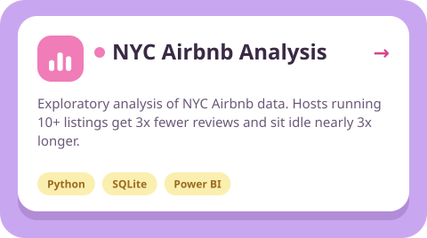
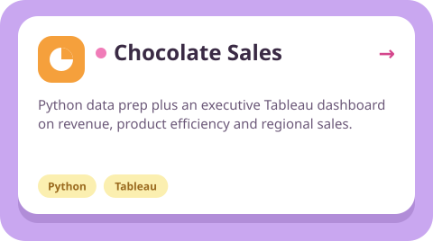
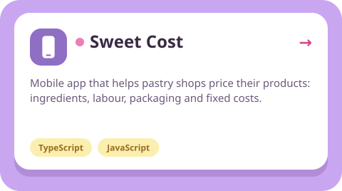
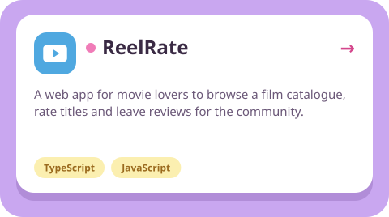

  

  
  
  
  

## ✿ About me

I'm **Ana**, a data analyst and developer in the making, and a recent **Computer Science** graduate.

Currently developing skills in **Python, SQL and BI tools**, building dashboards and pipelines that make numbers easier to talk about.

- 🌱 **Currently working on:** [fitointer-sus](https://github.com/anxmarks/fitointer-sus)

## ✿ Skills ✿

  

## ✿ Featured projects

  
  
  
  

  

